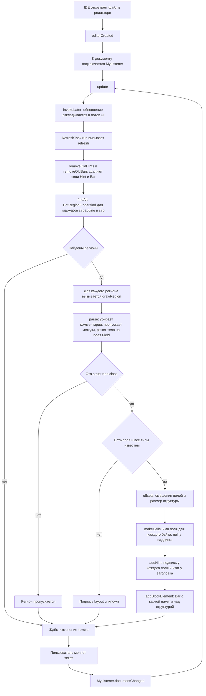
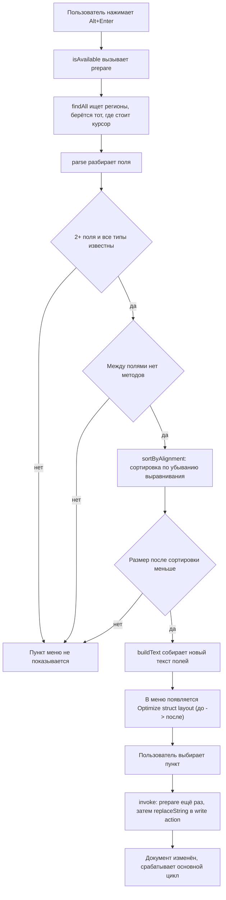

# Hot Path Highlighter

Плагин для IntelliJ IDEA и CLion. Помечаете C++ структуру комментарием, и в редакторе появляется её раскладка в памяти: смещение и размер каждого поля, общий размер, сколько байт ушло в паддинг. Есть действие, которое переставляет поля так, чтобы паддинга стало меньше.

## Что делает

Над структурой ставится маркер:

```cpp
// @p
struct Order {
    char side;
    long id;
    int qty;
};
```

После этого:

- у каждого поля справа пишется `offset N, size M`;
- у заголовка структуры пишется `size 24, wasted 11 B`;
- над структурой рисуется карта памяти: один квадрат на байт, 64 байта в ряд (одна кеш-линия). Каждое поле своего цвета, на первом байте поля стоит первая буква имени, паддинг красный. Сверху подпись вида `memory map 24 B, 1 cache line`.

Всё пересчитывается при каждом изменении текста.

### Optimize struct layout

Alt+Enter внутри структуры, пункт `Optimize struct layout (24 -> 16 B)`. Поля сортируются по убыванию выравнивания (`Order` станет `long`, `int`, `char`). Пункт появляется, только если размер реально уменьшится: у структуры хотя бы два поля, все типы известны и между полями нет методов (иначе при замене они были бы стёрты).

## Маркеры

Маркер должен стоять на отдельной строке прямо перед структурой. Подходят `// @p`, `//@p`, `/* @p */` и то же с `@padding`.

## Какие поля понимает

- `char`, `bool`, `short`, `int`, `long`, `float`, `double`, `intN_t`, `uintN_t`, `size_t`;
- указатели (всегда 8 байт);
- массивы с числовым размером;
- `std::string` (32 байта);
- `std::vector<T>` с любым `T`, например `std::vector<std::string>` (24 байта, сам объект без данных в куче);
- `std::atomic<T>` занимает столько же, сколько `T`.

Префикс `std::` необязателен. Модификаторы `unsigned`, `signed`, `const`, `volatile` и `long long` тоже разбираются. Всё после `=` или `{` (`int size = 10;`, `int size{10};`) игнорируется.

Методы и конструкторы (с телом и без) пропускаются: в объекте они места не занимают, учитываются только поля.

Размеры считаются как для 64-битной платформы: `long` и указатель по 8 байт. Выравнивание типа принимается равным его размеру, но не больше 8, поэтому у `vector` и `string` оно 8, а не 24 и 32.

Если встретился тип, которого плагин не знает, у структуры будет подпись `layout unknown`, карта и оптимизация для неё не работают.

## Ограничения

- не поддерживаются вложенные структуры и `enum`, наследование, битовые поля и `#pragma pack`;
- объявление нескольких полей через запятую (`int a, b;`) не разбирается, структура получит `layout unknown`;
- блочные комментарии `/* */` внутри структуры не вырезаются, поле с таким комментарием даст `layout unknown`. Однострочные `//` работают;
- при оптимизации комментарии внутри структуры пропадают: объявления полей записываются заново, каждое на своей строке;
- любое объявление со скобкой `(` считается методом, поэтому поле со значением по умолчанию вида `int x = foo(1);` и поле-указатель на функцию `void (*cb)();` пропускаются, и раскладка получится неточной;
- `std::atomic<T*>` не разбирается, структура получит `layout unknown`;
- у `virtual` методов есть указатель на таблицу виртуальных функций (8 байт в начале объекта), плагин его не учитывает;
- размеры `vector` (24) и `string` (32) заданы под MSVC и libstdc++. В libc++ (Clang, macOS) `string` занимает 24 байта.

## Архитектура

Два файла, Java, IntelliJ Platform.

| Файл                      | Роль                                                     |
|---------------------------|----------------------------------------------------------|
| `HotRegionFinder.java`    | Ищет в тексте маркеры и границы помеченных структур      |
| `HotPathHighlighter.java` | Разбирает поля, считает раскладку, рисует и оптимизирует |

Внутри `HotPathHighlighter` лежат классы `Field`, `Hint`, `Bar` и `Optimize`.

### Блок-схема работы

Основной цикл, от открытия файла до отрисовки. Дальше плагин ждёт правок текста и повторяет его с шага `update`.



Действие Alt+Enter. После замены текста документ меняется, и срабатывает основной цикл: разметка пересчитывается.



## Описание классов

### HotRegionFinder

| Метод                | Что делает                                               |
|----------------------|----------------------------------------------------------|
| `find(text, marker)` | Возвращает список регионов, помеченных заданным маркером |

`find(text, marker)`

- Принимает.
  - `text` - весь текст файла, тип `String`
  - `marker` - имя маркера, `@p` или `@padding`, тип `String`
- Возвращает.
  - список `Region`, тип `ArrayList<Region>`

`Region` хранит четыре смещения в тексте.

| Поле     | Значение                                      |
|----------|-----------------------------------------------|
| `mStart` | начало строки с маркером                      |
| `mEnd`   | конец строки с маркером                       |
| `bStart` | начало блока структуры (строка после маркера) |
| `bEnd`   | конец блока, позиция после закрывающей `}`    |

Регион не создаётся, если до первой `{` встретилась `;` (то есть после маркера идёт не структура).

### HotPathHighlighter

| Метод              | Что делает                                                                                        |
|--------------------|---------------------------------------------------------------------------------------------------|
| `editorCreated(e)` | Подписывается на изменения документа и запускает первую отрисовку                                 |
| `refresh(ed)`      | Удаляет старую разметку и рисует новую                                                            |
| `findAll(text)`    | Собирает регионы для маркеров `@padding` и `@p`                                                   |
| `parse(reg)`       | Вырезает однострочные комментарии, пропускает методы и превращает поля структуры в список `Field` |
| `sizeOf(type)`     | Возвращает размер базового типа (в том числе `vector` и `string`) или 0, если тип неизвестен      |
| `offsets(fields)`  | Считает смещение каждого поля и итоговый размер с выравниванием                                   |
| `allKnown(fields)` | Проверяет, что размер всех полей известен                                                         |

`parse(reg)`

- Принимает.
  - `reg` - текст региона от маркера до закрывающей скобки, тип `String`
- Возвращает.
  - список полей, тип `ArrayList<Field>`, или `null`, если это не `struct` и не `class`
- Как работает.
  - считает глубину фигурных скобок, поэтому `;` внутри тела метода полями не становятся
  - объявления со скобкой `(` пропускаются как методы
  - у типа убирается `std::`, у `atomic<T>` берётся `T`, у остальных шаблонов остаётся только имя шаблона
  - выравнивание поля равно `min(размер, 8)`

`offsets(fields)`

- Принимает.
  - `fields` - поля в порядке объявления, тип `ArrayList<Field>`
- Возвращает.
  - массив `int[]`, где элемент `i` это смещение поля `i`, а последний элемент это размер структуры

Вспомогательные классы.

| Класс      | Роль                                                                                  |
|------------|---------------------------------------------------------------------------------------|
| `Field`    | Одно поле, содержит имя, объявление, выравнивание, размер и позиции в тексте          |
| `Hint`     | Серая подпись в конце строки                                                          |
| `Bar`      | Блочная вставка над структурой с картой байтов                                        |
| `Optimize` | Действие Alt+Enter, переставляет поля. Не предлагается, если между полями стоит метод |

## Сборка и установка

```
git clone https://github.com/irumka/Hot-Path-Highlighter
cd Hot-Path-Highlighter
./gradlew buildPlugin
```

Затем в IDE открыть Settings, Plugins, значок шестерёнки, Install Plugin from Disk и выбрать zip из `build/distributions`.

Документация по комментариям собирается командой `./gradlew javadoc`.