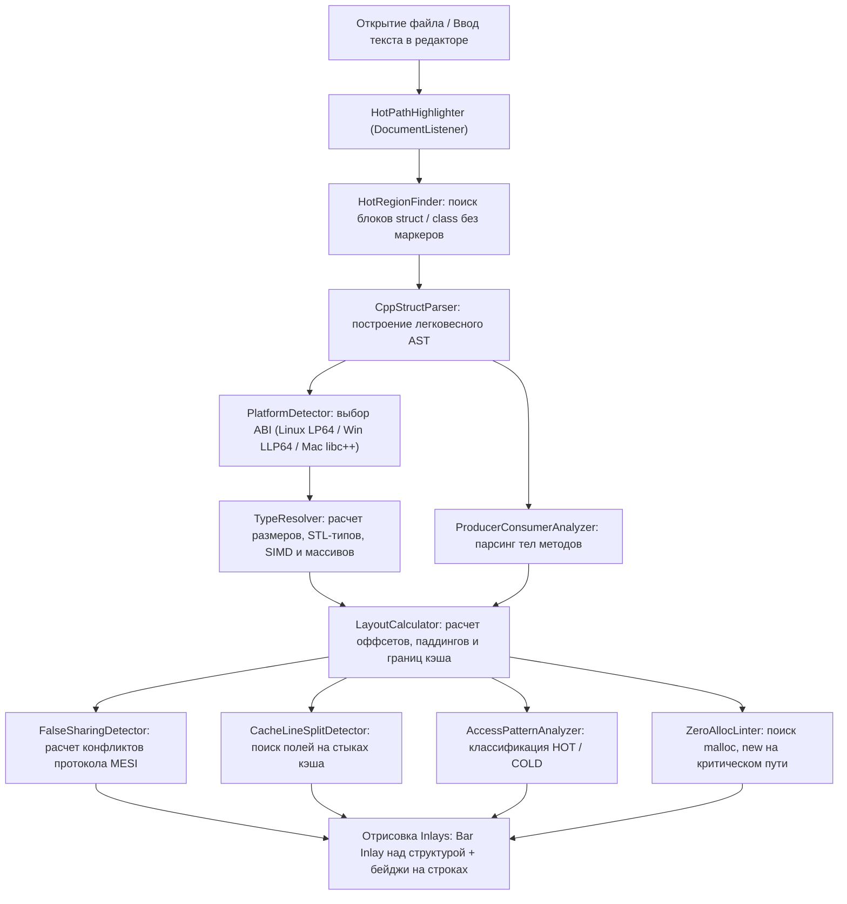
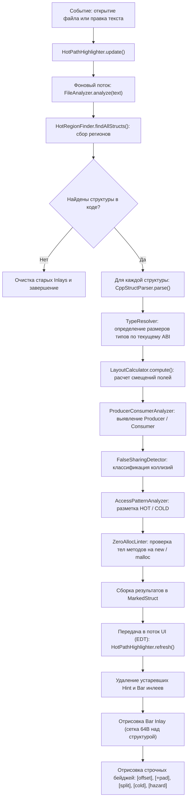
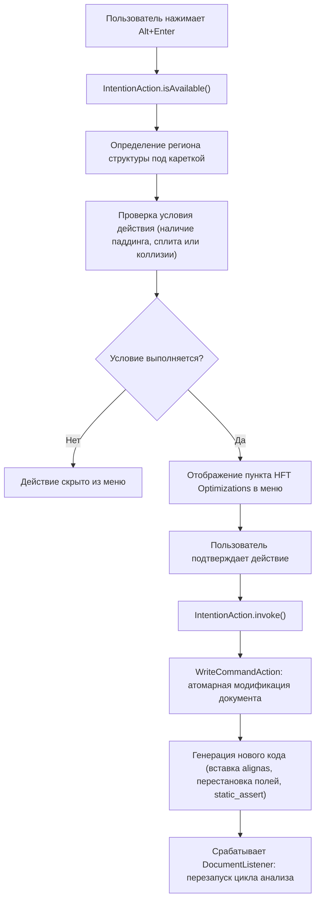

# HFT Optimizer (Hot Path Highlighter)

Плагин для CLion и IntelliJ IDEA для микроархитектурного статического анализа структур данных C++ в реальном времени.

Плагин без вызова компилятора и без сторонних демонов разбирает типы, рассчитывает бинарный макет в памяти (Memory Layout) с учетом целевого ABI компилятора, выявляет деградации задержек на уровне кремния (промахи в кэш первого уровня L1D, разрывы шины когерентности памяти MESI, расщепление кэш-линий, сброс конвейера процессора, непреднамеренные аллокации в куче) и предоставляет набор действий Alt+Enter (Intention Actions) для их исправления.

---

## 1. Что делает плагин

Плагин работает полностью автоматически: находит в коде любые определения `struct` и `class` (маркер `// @p` поддерживается для обратной совместимости, но больше не требуется).

Для каждой найденной структуры плагин:

1. **Строит карту памяти (Bar Inlay)** прямо над строкой объявления:
  - Сетка размером по 64 байта в ряд (одна строка кэша процессора L1D).
  - Каждый байт отображается ячейкой. Байт данных окрашивается уникальным цветом поля с первой буквой имени.
  - Байт пустого заполнителя (паддинг компилятора) подсвечивается красным цветом.
  - Байты, на которых обнаружена межъядерная коллизия памяти (False Sharing), перечеркиваются сигнальной полосой.
  - При наведении курсора мыши на любой квадрат сетки всплывает интерактивный Hover-инспектор: точный абсолютный оффсет байта, диапазон кэш-линии, имя поля, тип и характер обнаруженного конфликта.
2. **Выводит статусную сводку** в конце строки заголовка:
  - Общий размер: `24B (pad 11B) [WARNING]` или `64B [FALSE SHARING]`, `64B [alloc hazard]`.
3. **Размещает инлайн-подсказки (Line End Inlays)** справа от каждого поля:
  - Оффсет и размер: `off 0, 8B`.
  - Дыры неиспользуемого паддинга: `[+7B pad]`.
  - Поля, пересекающие границу строки кэша: `[split]`.
  - Характер межъядерного конфликта: `[write ping-pong]`, `[read invalidation]`, `[array conflict]`.
  - Температурную классификацию: `[cold]` для выноса из критического пути.

Все расчеты пересчитываются асинхронно прямо во время редактирования текста.

---

## 2. Физика аппаратных задержек и аппаратные аномалии

В системах с ультранизкой задержкой (HFT, Kernel-Bypass сетевые стеки, торговые шлюзы бирж) оптимизация по $O(N)$ недостаточна: алгоритмически оптимальный код теряет сотни наносекунд из-за задержек кремния.

### 2.1. Стоимость задержек в тактах процессора (x86_64 @ 4.5 GHz)

| Тип обращения / Аномалия | Такты CPU | Задержка | Физическая причина на кристалле |
|:---|:---:|:---:|:---|
| **L1D Cache Hit** | 4–5 | ~1.0 нс | Локальная SRAM память ядра CPU |
| **L2 Cache Hit** | 12–14 | ~3.0 нс | Локальный кэш второго уровня |
| **L3 Cache Hit (Shared)** | 40–50 | ~10–12 нс | Общий кэш кристалла, опрос кольцевой шины Ring/Mesh |
| **Main Memory (DRAM)** | 220–300 | ~50–65 нс | Перезарядка конденсаторов шины DDR4/DDR5 |
| **False Sharing (MESI RFO)** | 120–280 | ~30–60 нс | Инвалидация строки кэша, ожидание подтверждения по шине |
| **Cache Line Split (Load)** | 16–28 | ~4–6 нс | Аппаратная сборка регистра из двух независимых выборок L1D |
| **Split Lock (Atomic Read-Modify-Write)** | 800–2500 | ~200–550 нс | Аппаратная блокировка общей шины ядрами процессора |
| **Store Forwarding Stall (4K Aliasing)** | 18–25 | ~4–5 нс | Коллизия бит [11:0] адреса в очереди Store Buffer |
| **Heap Allocation (`malloc` / `new`)** | 1500–5000+ | ~350–1200+ нс | Блокировка арены аллокатора, системный вызов ядра ОС |
| **Деление `%` вместо `&`** | 18–32 | ~4–7 нс | Неконвейеризируемый микрокод аппаратного делителя |

---

### 2.2. Архитектурные схемы аномалий

#### Аномалия 1: False Sharing (Коллизия шины когерентности MESI)

Возникает, когда две независимые переменные, используемые разными потоками на разных ядрах, физически располагаются внутри одной 64-байтной строки кэша.

```
КЭШ-ЛИНИЯ #0 (64 байта в оперативной памяти)
┌─────────────────────────┬─────────────────────────┬───────────────────────┐
│     tail (8 байт)       │      head (8 байт)      │   Padding (48 байт)   │
└────────────┬────────────┴────────────┬────────────┴───────────────────────┘
             │                         │
     Поток-Consumer             Поток-Producer
     читает/пишет               пишет
             ▼                         ▼
      ┌──────────────┐          ┌──────────────┐
      │    Core 0    │          │    Core 1    │
      └──────────────┘          └──────────────┘
```

**Механизм деградации:**
1. Ядро 1 пишет в `head`. Чтобы получить монопольное право на запись, оно рассылает по шине широковещательный запрос **RFO (Request For Ownership)**.
2. Протокол MESI переводит состояние строки кэша в ядре 0 из **Shared [S]** в **Invalid [I]**.
3. Когда ядро 0 пытается прочитать `tail`, оно получает аппаратный промах (Cache Miss), замораживает исполнение инструкций конвейера и вынуждено выгружать строку заново, теряя до 280 тактов.

#### Аномалия 2: Cache Line Split (Разрыв переменной между кэш-линиями)

Возникает, когда скалярное поле начинается в конце одной строки кэша и заканчивается в начале следующей.

```
КЭШ-ЛИНИЯ #0 (Байты 0..63)              КЭШ-ЛИНИЯ #1 (Байты 64..127)
┌───────────────────────┬────────────┐ ┌────────────┬───────────────────────┐
│  header [0..59]       │  ts [0..3] │ │  ts [4..7] │  length [68..71]      │
└───────────────────────┴──────┬─────┘ └─────┬──────┴───────────────────────┘
                               └──────┬──────┘
                               Поле timestamp
```

**Механизм деградации:**
Процессор не способен прочитать такое поле за одну микрооперацию ($\mu\text{op}$). Генерируются два раздельных чтения кэша, за которыми следует склейка байтов через битовые сдвиги. Если это атомарная переменная (`std::atomic<int64_t>`), процессор активирует глобальный сигнал `#LOCK`, замораживая доступ к оперативной памяти для остальных процессорных ядер.

#### Аномалия 3: Array False Sharing (Коллизия в пуле потоков)

Возникает при создании массива структур малого размера для параллельных воркеров.

```
Массив: Worker workers[8];  // sizeof(Worker) = 4 байта

       КЭШ-ЛИНИЯ #0 (64 байта)
┌───────┬───────┬───────┬───────┬───────┬───────┬───────┬───────┬───────────┐
│ W0:4B │ W1:4B │ W2:4B │ W3:4B │ W4:4B │ W5:4B │ W6:4B │ W7:4B │ 32B Free  │
└───────┴───────┴───────┴───────┴───────┴───────┴───────┴───────┴───────────┘
    │       │       │       │       │       │       │       │
  Core 0  Core 1  Core 2  Core 3  Core 4  Core 5  Core 6  Core 7
```

Все 8 процессорных ядер молотят в одну и ту же физическую ячейку L1. Параллельная обработка работает медленнее, чем последовательный однопоточный код.

---

## 3. Каталог быстрых исправлений (Alt+Enter QuickFixes)

При установке курсора на проблемный участок структуры или метода плагин предлагает контекстные действия группы **HFT Optimizations**:

| QuickFix | Название действия | Что выполняет |
|:---|:---|:---|
| **Layout Optimization** | `Optimize struct layout` | Сортирует поля по невозрастанию их выравнивания (например: 8B $\to$ 4B $\to$ 2B $\to$ 1B). Устраняет паддинг, уменьшая структуру до минимального размера без поломки ABI. |
| **False Sharing Fix** | `Add padding to eliminate false sharing` | Определяет поле, вызывающее MESI-конфликт, и изолирует его добавлением `alignas(64)` с сохранением исходных отступов кода. |
| **Cache Line Split Fix** | `Align field to prevent cache line split` | Находит скалярное поле на стыке строк и вставляет перед ним `alignas(64)`, сдвигая его на чистую границу. |
| **Hot/Cold Separation** | `Separate hot and cold data` | Пересобирает структуру: горячие счетчики и цены группирует в первой кэш-линии (первые 64 байта), а холодные контейнеры, строки и логи сдвигает во вторую кэш-линию через `alignas(64)`. |
| **Producer/Consumer Split** | `Reorganize to separate producer/consumer` | Группирует методы и поля записи (Producer) отдельно от полей чтения (Consumer), выравнивая каждую группу на свою независимую строку кэша. |
| **Array Hazard Fix** | `Align worker array 'X' elements to 64B` | Находит определение структуры элемента пула воркеров и выравнивает саму структуру до 64 байт (`struct alignas(64) WorkerContext`), устраняя коллизии в массивах. |
| **SIMD Crash Guard** | `Fix SIMD SIGSEGV hazard` | При обнаружении полей `__m128`, `__m256`, `__m512` добавляет к заголовку структуры выравнивание `alignas(16/32/64)`. Предотвращает падение программы с кодом SIGSEGV (GP-fault) при исполнении инструкций выровненной векторной загрузки (`_mm256_load_si256`). |
| **Spinloop Optimization** | `Insert _mm_pause() into spinloop` | Находит пустые или ультраплотные циклы ожидания (`while (flag.load()) ;`) и вставляет в их тело микроинструкцию `_mm_pause()`, предотвращая аппаратную блокировку конвейера процессора и снижая энергопотребление ядра. Автоматически добавляет `#include <immintrin.h>`. |
| **Bitwise Fast Indexing** | `Replace '%' with bitwise '& (N - 1)'` | Заменяет операцию целочисленного деления `(idx + 1) % QUEUE_SIZE` на побитовое И `(idx + 1) & (QUEUE_SIZE - 1)`. Ускоряет индексацию с 25 тактов CPU до 1 такта. |
| **CI/CD Layout Guard** | `Generate compile-time static_assert guards` | Генерирует в конце структуры блок директив `static_assert(sizeof(...) == N)` и `static_assert(offsetof(...) == M)` для всех полей. Защищает бинарный протокол от незаметного расползания оффсетов при смене компилятора или платформы. |
| **Global Atomics Audit Fix** | `Align global atomic 'X' to 64B` | Находит смежные глобальные и статические атомики в секциях `.bss`/`.data`, находящиеся ближе 250 байт друг к другу, и вставляет `alignas(64)` перед вторым атомиком. |

---

## 4. Архитектурный пайплайн плагина



---

## 5. Блок-схемы работы плагина

### 5.1. Основной цикл анализа и отрисовки



---

### 5.2. Алгоритм применения быстрых исправлений (Alt+Enter)



---

## 6. Детальное описание функций и классов плагина

### 6.1. Пакет `analysis`

#### `PlatformDetector.java`
* `getEffectivePlatform(TargetPlatform target)`: Определяет результирующий ABI компилятора. Если выбрано `AUTO`, считывает системное свойство `os.name`. Возвращает `LINUX_GCC` (LP64), `WINDOWS_MSVC` (LLP64) или `MACOS_CLANG` (LP64 с libc++).
* `isWindows(...)`, `isMac(...)`, `isLinux(...)`: Предикаты для проверки целевой операционной системы и компилятора.

#### `TypeResolver.java`
* `resolve(String rawType, TargetPlatform platform, Map<String, int[]> customTypes)`: Главная точка входа разрешения типа. Возвращает объект `TypeInfo(size, align, isAtomic)`. Ведет потокобезопасный кэш `ConcurrentHashMap` по ключу `Platform:Type`.
* `resolveDirect(...)`: Низкоуровневый разбор типа:
  * Указатели (`*`) и ссылки (`&`) $\to$ размер 8 байт, выравнивание 8 байт.
  * Шаблоны `std::atomic<T>` $\to$ извлекает внутренний тип $T$, наследует его размер и выравнивание, выставляет флаг `isAtomic = true`.
  * Шаблоны `std::array<T, N>` и массивы `T[N]` $\to$ размер $\text{sizeof}(T) \times N$, выравнивание $T$.
  * Примитивные типы $\to$ `int8_t`/`char` (1B), `int16_t`/`short` (2B), `int32_t`/`int`/`float` (4B), `int64_t`/`long long`/`double` (8B).
  * Платформенно-зависимые типы $\to$ `long`: 4 байта на Windows MSVC (LLP64), 8 байт на Linux GCC/Clang (LP64). `long double`: 8 байт на MSVC, 16 байт на GCC. `wchar_t`: 2 байта на MSVC, 4 байта на GCC.
  * SIMD-векторы $\to$ `__m128` (16B / align 16B), `__m256` (32B / align 32B), `__m512` (64B / align 64B).
  * STL-контейнеры $\to$ `std::string`: 24 байта для libc++ (Apple Clang), 32 байта для libstdc++/MSVC. `std::vector`: 24 байта. `std::string_view`: 16 байт. `std::unique_ptr`: 8 байт. `std::shared_ptr`: 16 байт.
* `clearCache()`: Сбрасывает кэш типов при смене настроек платформы в UI.

#### `CacheLineSplitDetector.java`
* `findSplits(Layout layout, int cacheLineSize)`: Сканирует поля структуры размером $> 1$ байта. Для каждого поля вычисляет строку начала `offset / lineSize` и строку окончания `(offset + size - 1) / lineSize`. При их неравенстве создает дескриптор `SplitField` с расчетом необходимого паддинга `cacheLineSize - (offset % cacheLineSize)`.

#### `AccessPatternAnalyzer.java`
* `analyze(StructInfo info, String structBlockText)`: Классифицирует каждое поле по частоте доступа:
  * `HOT`: Поля, имена которых содержат токены котировок, объемов и меток времени (`price`, `qty`, `volume`, `order_id`, `ts`, `seq`, `mask`), либо имеющие тип `std::atomic`.
  * `COLD`: Поля, имена которых указывают на логи, ошибки и текст (`err`, `error`, `log`, `desc`, `msg`, `comment`), тяжелые буферы (`std::string`, `vector`), либо поля, чтение которых происходит только в диагностических методах (`to_string`, `dump`, `serialize`).
  * `NEUTRAL`: Общие скалярные поля.

#### `ZeroAllocLinter.java`
* `inspectMethodBodies(String structBlockText, int regionStartOffset)`: Ищет скрытые аллокации в куче на горячем пути с помощью регулярного выражения: вызовы операторов `new`, `new[]`, функций `malloc`, `calloc`, `realloc`, `aligned_alloc`, `posix_memalign`, фабрик `std::make_unique`, `std::make_shared`. Возвращает список объектов `AllocationHazard` с точным оффсетом в файле.
* `hasZeroAllocHazards(...)`: Быстрый предикат для вывода бейджа `[alloc hazard]` в шапке структуры.

---

### 6.2. Пакет `core`

#### `ProducerConsumerAnalyzer.java`
* `extractMethodsRobust(String structBlockText)`: Производит извлечение методов структуры. Корректно подсчитывает баланс вложенных фигурных скобок `{ ... }`, корректно обрабатывая сложные методы с вложенными ветвлениями `if`, циклами `while` и `for`.
* `analyze(StructInfo info, String structBlockText)`:
  * Анализирует имя структуры: контейнеры очередей (`queue`, `ringbuffer`, `spsc`, `disruptor`) помечаются как `QUEUE_OR_RINGBUFFER`. Классы-оркестраторы (`manager`, `orchestrator`, `config`, `service`) помечаются как `CONTROL_PLANE`.
  * Разбирает доступ к полям в телах методов: операции записи (присваивания `=`, инкременты `++`, декременты `--`, вызовы `.store()`, `.exchange()`, `.fetch_add()`) маркируют поле как `WRITE_ONLY`. Обращения без записи маркируют поле как `READ_ONLY`. Поля, которые и читаются, и пишутся, получают статус `READ_WRITE`.
* `isConcurrent()`: Определяет, работает ли структура в многопоточном окружении (наличие атомиков, мьютексов или раздельного доступа разных методов к разным полям).

#### `FalseSharingDetector.java`
* `detect(List<CacheField> fields, int cacheLineSize, StructProfile profile)`:
  * Проверяет структуру на параллелизм. Для однопоточных структур и классов `CONTROL_PLANE` возвращает статус `SAFE`, исключая ложные срабатывания.
  * Детектирует **Array Hazard**: элементы массива структур меньше 64 байт делят общую строку кэша.
  * Детектирует **Buffer Collision**: внутренний буфер данных очереди находится на одной строке с атомарными индексами.
  * Детектирует **Write-Write Ping-Pong**: два потока/метода пишут в разные переменные на одной строке кэша (наивысшая опасность инвалидации).
  * Детектирует **Read Invalidation**: один поток пишет в поле, а второй поток непрерывно читает соседнее поле на той же строке кэша.
  * Детектирует **Potential**: атомик делит строку со скалярными данными.

#### `GlobalAtomicsAudit.java`
* `audit(String fullDocumentText, int cacheLineSize)`: Анализирует весь документ на наличие статических и глобальных атомиков (`static std::atomic<int> g_counter;`). Находит переменные, объявленные без выравнивания `alignas` на расстоянии менее 250 символов друг от друга, регистрируя коллизию смежного размещения в сегментах памяти `.bss` и `.data`.

---

### 6.3. Пакет `dev.hotpath`

#### `HotRegionFinder.java`
* `findAllStructs(String text)`: Ищет блоки определений `struct`, `class` и `union`. Корректно обрабатывает спецификаторы `alignas(...)`, атрибуты `[[...]]`, ключевые слова `final` и список наследования.
* `findMatchingBrace(String text, int openBraceIdx)`: Находит парную закрывающую фигурную скобку `}` с пропуском однострочных (`//`) и блочных (`/* */`) комментариев, а также строковых литералов (`"..."`).

#### `CppStructParser.java`
* `parse(String regionText)`: Разбирает тело структуры на поля. Вырезает комментарии, извлекает директивы `#pragma pack` и `alignas` самой структуры.
* `addStatement(...)`: Разбирает инструкцию C++ до символа `;`. Пропускает статические члены `static`, объявления типов `using`/`typedef` и методы. Корректно отличает поля с `alignas(...)` и значениями по умолчанию (`= 0`) от методов.
* `parseField(String s)`: Извлекает имя поля, тип, битовые поля (`: N`), размерности массивов (`[10]`), директивы `alignas(...)` поля.
* `Field.toFullCode(String indent)`: Воссоздает синтаксически корректный C++ код поля с сохранением оригинальных комментариев и отступов при рефакторингах.

#### `LayoutCalculator.java`
* `compute(StructInfo info, HashMap<String, int[]> locals)`:
  * Учитывает наличие виртуальных функций (резервирует указатель на vtable `vptr` размером 8 байт по оффсету 0).
  * Последовательно упаковывает поля: вычисляет смещение каждого поля с округлением вверх до границы его выравнивания (`roundUp(pos, align)`).
  * Формирует список промежутков пустого пространства (`Gap`).
  * Рассчитывает суммарный размер структуры с выравниванием по наибольшему выравниванию ее полей или собственному `alignas`.
  * Вычисляет процент потерь (`wasted`) и индекс здоровья структуры `healthScore` от 0 до 100.
* `computeUnion(...)`: Реализует параллельное наложение полей в памяти для `union` (все поля начинаются с оффсета `vptr`).

#### `HotPathHighlighter.java`
* `editorCreated(...)` / `editorReleased(...)`: Регистрирует слушатели изменений документа и перемещения мыши для редактора.
* `refresh(Editor ed)`: Запускает полный цикл анализа и обновляет Inlay-компоненты редактора.
* `Bar` (EditorCustomElementRenderer): Рисует графическую цветовую сетку кэш-линий прямо над кодом структуры с нумерацией строк и разметкой паддинга.
* `Bar.showHoverTooltip(...)`: Формирует и выводит HTML-тултип инспектора байта с метаданными при наведении курсора мыши.
* `Optimize` (IntentionAction): Реализует алгоритм перестановки полей структуры по убыванию выравнивания для сжатия паддинга.

#### `MemoryMapRenderer.java`
* Реализует масштабируемую отрисовку карты памяти для ToolWindow и системных диалоговых окон. Поддерживает несколько цветовых палитр (Classic, High Contrast, Neon Cyberpunk).

#### `FileAnalyzer.java`
* `analyze(String text)`: Выполняет пакетный двухпроходный анализ всех структур файла в фоновом потоке, разрешая взаимные зависимости типов между структурами.

---

### 6.4. Пакет `optimization` (Действия Alt+Enter)

* **`CacheLineAlignerIntention.java`**: Вставляет `alignas(64)` непосредственно после ключевого слова `struct` или `class`, либо обновляет существующий `alignas`.
* **`CacheLineSplitFixerIntention.java`**: Находит поле, разорванное границей 64 байт, и добавляет к нему `alignas(64)`.
* **`FalseSharingFixerIntention.java`**: Определяет конфликтующее поле в паре False Sharing и изолирует его с помощью `alignas(64)`.
* **`ArrayFalseSharingFixerIntention.java`**: Находит структуру элемента воркер-пула и добавляет выравнивание `alignas(64)` к ее объявлению.
* **`HotColdSeparatorIntention.java`**: Группирует поля класса на секции `// --- Hot Path Data ---` и `// --- Cold / Diagnostic Data ---` с директивой `alignas(64)` перед холодной секцией.
* **`ReorganizeProducerConsumerIntention.java`**: Группирует поля на секции Producer, Consumer и General Data, разнося их по отдельным строкам кэша.
* **`SIMDCrashGuardIntention.java`**: Добавляет выравнивание `alignas(16/32/64)` к структуре, содержащей поля `__m128`, `__m256` или `__m512`.
* **`SpinloopPauseIntention.java`**: Вставляет инструкцию `_mm_pause()` внутрь пустого или непустого цикла `while`, сохраняя существующий код в теле цикла. При необходимости добавляет `#include <immintrin.h>`.
* **`BitwiseMaskIntention.java`**: Заменяет `expr % DIVISOR` на `expr & (DIVISOR - 1)` с корректной расстановкой скобок с учетом приоритетов операций C++.
* **`CompileTimeGuardIntention.java`**: Генерирует в конце структуры блок `static_assert(sizeof(...) == N)` и `static_assert(offsetof(...) == M)` с автоматическим добавлением `#include <cstddef>`.
* **`GlobalAtomicAlignerIntention.java`**: Выравнивает статические переменные `std::atomic` на границу 64 байт.

---

### 6.5. Пакет `ui`

* **`HFTSettings.java`**: Персистентный сервис приложения (`@State`, `@Storage("hft_optimizer_settings.xml")`), сохраняющий флаги визуализации, лимиты строк карты памяти, размер кэш-линии (32, 64, 128, 256 байт), цветовую тему и целевой ABI компилятора.
* **`HFTSettingsConfigurable.java`**: Предоставляет интерфейс настроек в окне `Settings | Tools | HFT Optimizer`.
* **`HFTSettingsPanel.java`**: Пользовательский интерфейс на базе `FormBuilder` с кнопками быстрых пресетов («All Features ON», «Low Noise (Critical Only)», «Disable All») и кнопкой ручного перезапуска анализа.
* **`HFTToolWindowFactory.java`**: Создает боковое окно управления (ToolWindow) на правой панели CLion для переключения настроек в реальном времени.
* **`VisualizationManager.java`**: Проектный сервис, отслеживающий открытие/закрытие редакторов, проверяющий расширения файлов (`.cpp`, `.cxx`, `.cc`, `.c`, `.h`, `.hpp`, `.hxx`) и рассылающий сигналы обновления через топик `HFTSettingsListener.TOPIC`.

---

## 7. Полигон для тестирования плагина (`test_suite.cpp`)

Для проверки всех аналитических модулей и действий Alt+Enter создайте файл `test_suite.cpp`:

```cpp
#include <cstdint>
#include <string>
#include <atomic>

// 1. ТЕСТ: Неоптимальный паддинг
// Плагин покажет: 32B (pad 11B) [WARNING]
// Бейджи на строках: [+7B pad] и [+4B pad]
// Действие Alt+Enter: "Optimize struct layout (32 -> 24B)"
struct TestPadding {
    char a;        // 1B + 7B pad
    double b;      // 8B
    int c;         // 4B + 4B pad
    int64_t d;     // 8B
};

// 2. ТЕСТ: Cache Line Split (пересечение границы 64 байт)
// Плагин покажет маркер [split] на поле 'timestamp'
// Действие Alt+Enter: "Align field 'timestamp' to cache line (alignas 64)"
struct [[gnu::packed]] TestSplit {
    char header[60];
    int64_t timestamp; // off 60..67 [split]
    int32_t length;
};

// 3. ТЕСТ: False Sharing (Producer / Consumer в одной строке)
// Плагин покажет статус [FALSE SHARING] и маркер [write ping-pong]
// Действие Alt+Enter: "Add padding to eliminate false sharing"
struct TestQueue {
    int64_t tail; // Consumer читает
    int64_t head; // Producer пишет
    void push() { head++; }
    int64_t pop() { return tail; }
};

// 4. ТЕСТ: Hot / Cold разделение данных
// Плагин пометит 'debug_code' и 'error_msg' маркером [cold]
// Действие Alt+Enter: "Separate hot and cold data"
struct TestHotCold {
    int64_t price;         // Hot
    int32_t debug_code;    // Cold [cold]
    int64_t volume;        // Hot
    std::string error_msg; // Cold [cold]
};

// 5. ТЕСТ: Array False Sharing (Массив воркеров)
// Плагин пометит маркер [array conflict]
// Действие Alt+Enter: "Align worker array 'workers' elements to 64B"
struct WorkerCtx {
    std::atomic<int> counter; // 4 байта
};

struct TestWorkerPool {
    WorkerCtx workers[8]; // 8 воркеров умещаются в 32 байта!
};

// 6. ТЕСТ: Класс-оркестратор (Проверка на ложные срабатывания)
// Плагин ДОЛЖЕН показать статус [OK] без False Sharing!
class TaskManager {
    int max_threads;
    int task_counter;
    void add() { task_counter++; }
    int get() { return task_counter; }
};

// 7. ТЕСТ: Замена медленного деления на побитовую маску
// Поставьте курсор на строку с '%'
// Действие Alt+Enter: "Replace '%' with bitwise '& (BUFFER_SIZE - 1)'"
void test_indexing(uint64_t id) {
    constexpr uint64_t BUFFER_SIZE = 1024;
    uint64_t next_idx = (id + 1) % BUFFER_SIZE;
}

// 8. ТЕСТ: Вставка _mm_pause в спинлок
// Поставьте курсор на 'while'
// Действие Alt+Enter: "Insert _mm_pause() into spinloop"
void test_spin(std::atomic<bool>& lock) {
    while (lock.load()) ;
}
```

---

## 8. Сборка и установка

### Требования
* JDK 17 или JDK 21
* CLion 2023.3+ / IntelliJ IDEA 2023.3+ (включая CLion Nova)
* Gradle 8.x

### Команды сборки

```bash
# Клонирование репозитория
git clone https://github.com/irumka/Hot-Path-Highlighter.git
cd Hot-Path-Highlighter

# Сборка установочного ZIP-архива плагина
./gradlew buildPlugin

# Запуск изолированной тестовой среды CLion с установленным плагином
./gradlew runIde
```

Готовый архив для установки находится в папке: `build/distributions/HotPathHighlighter-X.X.X.zip`.

Установка в IDE: `Settings | Plugins | ⚙️ (Шестеренка) | Install Plugin from Disk...` и выбрать собранный ZIP-архив.