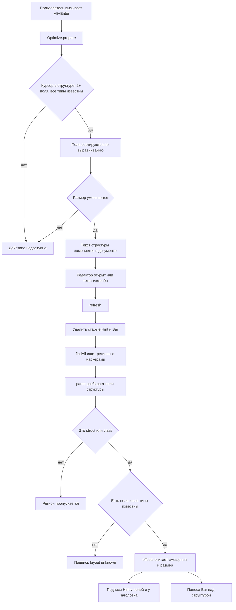

# Hot Path Highlighter

Плагин для IntelliJ IDEA и CLion. Помечаете C++ структуру комментарием, и в редакторе появляется её раскладка в памяти: смещение и размер каждого поля, общий размер, сколько байт ушло в паддинг. Есть действие, которое переставляет поля так, чтобы паддинга стало меньше.

## Что делает

Над структурой ставится маркер:

```cpp
// @p
struct Order {
    char side;
    long id;
    int qty;
};
```

После этого:

- у каждого поля справа пишется `offset N, size M`;
- у заголовка структуры пишется `size 24, wasted 11 B`;
- над структурой рисуется карта памяти: один квадрат на байт, 64 байта в ряд (одна кеш-линия). Каждое поле своего цвета, на первом байте поля стоит первая буква имени, паддинг красный. Сверху подпись вида `memory map 24 B, 1 cache line`.

Всё пересчитывается при каждом изменении текста.

### Optimize struct layout

Alt+Enter внутри структуры, пункт `Optimize struct layout (24 -> 16 B)`. Поля сортируются по убыванию выравнивания (`Order` станет `long`, `int`, `char`). Пункт появляется, только если размер реально уменьшится: у структуры хотя бы два поля и все типы известны.

## Маркеры

Маркер должен стоять на отдельной строке прямо перед структурой. Подходят `// @p`, `//@p`, `/* @p */` и то же с `@padding`.

## Какие поля понимает

`char`, `bool`, `short`, `int`, `long`, `float`, `double`, `intN_t`, `uintN_t`, `size_t`, указатели, массивы с числовым размером, `std::atomic<T>`. Модификаторы `unsigned`, `signed`, `const`, `volatile` и `long long` тоже разбираются. Значение по умолчанию (`int size = 10;`) игнорируется.

Размеры считаются как для 64-битной платформы: `long` и указатель по 8 байт. Выравнивание типа принимается равным его размеру.

Если встретился тип, которого плагин не знает, у структуры будет подпись `layout unknown`, карта и оптимизация для неё не работают.

## Ограничения

- не поддерживаются вложенные структуры, наследование, битовые поля и `#pragma pack`;
- объявление нескольких полей через запятую (`int a, b;`) не разбирается, структура получит `layout unknown`;
- блочные комментарии `/* */` внутри структуры не вырезаются, поле с таким комментарием даст `layout unknown`. Однострочные `//` работают;
- при оптимизации комментарии внутри структуры пропадают: объявления полей записываются заново, каждое на своей строке.

## Архитектура

Два файла, Java, IntelliJ Platform.

| Файл | Роль |
|---|---|
| `HotRegionFinder.java` | Ищет в тексте маркеры и границы помеченных структур |
| `HotPathHighlighter.java` | Разбирает поля, считает раскладку, рисует и оптимизирует |

Внутри `HotPathHighlighter` лежат классы `Field`, `Hint`, `Bar` и `Optimize`.

### Блок-схема работы



## Описание классов

### HotRegionFinder

| Метод | Что делает |
|---|---|
| `find(text, marker)` | Возвращает список регионов, помеченных заданным маркером |

`find(text, marker)`

- Принимает.
  - `text` - весь текст файла, тип `String`
  - `marker` - имя маркера, `@p` или `@padding`, тип `String`
- Возвращает.
  - список `Region`, тип `ArrayList<Region>`

`Region` хранит четыре смещения в тексте.

| Поле | Значение |
|---|---|
| `mStart` | начало строки с маркером |
| `mEnd` | конец строки с маркером |
| `bStart` | начало блока структуры (строка после маркера) |
| `bEnd` | конец блока, позиция после закрывающей `}` |

Регион не создаётся, если до первой `{` встретилась `;` (то есть после маркера идёт не структура).

### HotPathHighlighter

| Метод | Что делает |
|---|---|
| `editorCreated(e)` | Подписывается на изменения документа и запускает первую отрисовку |
| `refresh(ed)` | Удаляет старую разметку и рисует новую |
| `findAll(text)` | Собирает регионы для маркеров `@padding` и `@p` |
| `parse(reg)` | Вырезает однострочные комментарии и превращает тело структуры в список полей |
| `sizeOf(type)` | Возвращает размер встроенного типа или 0, если тип неизвестен |
| `offsets(fields)` | Считает смещение каждого поля и итоговый размер с выравниванием |
| `allKnown(fields)` | Проверяет, что размер всех полей известен |

`parse(reg)`

- Принимает.
  - `reg` - текст региона от маркера до закрывающей скобки, тип `String`
- Возвращает.
  - список полей, тип `ArrayList<Field>`, или `null`, если это не `struct` и не `class`

`offsets(fields)`

- Принимает.
  - `fields` - поля в порядке объявления, тип `ArrayList<Field>`
- Возвращает.
  - массив `int[]`, где элемент `i` это смещение поля `i`, а последний элемент это размер структуры

Вспомогательные классы.

| Класс | Роль |
|---|---|
| `Field` | Одно поле, содержит имя, объявление, выравнивание, размер и позиции в тексте |
| `Hint` | Серая подпись в конце строки |
| `Bar` | Блочная вставка над структурой с картой байтов |
| `Optimize` | Действие Alt+Enter, переставляет поля |

## Сборка и установка

```
git clone https://github.com/irumka/Hot-Path-Highlighter
cd Hot-Path-Highlighter
./gradlew buildPlugin
```

Затем в IDE открыть Settings, Plugins, значок шестерёнки, Install Plugin from Disk и выбрать zip из `build/distributions`.

Документация по комментариям собирается командой `./gradlew javadoc`.